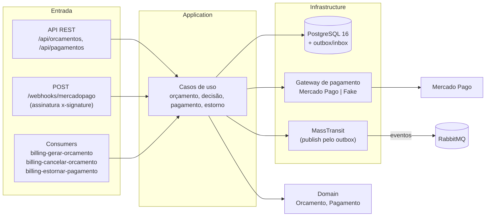
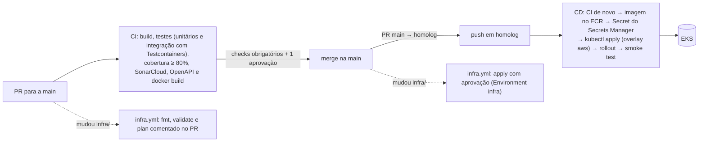

# oficina-billing-service

[](https://sonarcloud.io/summary/new_code?id=Duds27_oficina-billing-service) [](https://sonarcloud.io/summary/new_code?id=Duds27_oficina-billing-service)

Microsserviço de **orçamento e pagamento** da Oficina Mecânica (FIAP 15SOAT, Fase 4).

> **Estado atual (Fase 4):** implementado e validado fora da AWS. Etapas 1 a 5 concluídas; a implantação no EKS, o New Relic com dados e o sandbox do Mercado Pago estão na [Etapa 6](https://github.com/Duds27/oficina-os-service/blob/main/docs/fase4/etapa-6-documentacao-entrega.md#60-implantação-na-aws-e-validação-no-new-relic).

## Responsabilidades

- Gerar o orçamento a partir do comando `GerarOrcamento` e enviá-lo ao cliente.
- Registrar a aprovação ou a recusa do cliente.
- Cobrar pelo Mercado Pago (Checkout Pro) e confirmar pelo webhook.
- Estornar o pagamento quando a saga mandar (`EstornarPagamento`).

**Não é dele:**

- Cadastro de clientes, veículos e peças, e o ciclo de vida da OS: são do `os-service`.
- A fila de execução: é do `execution-service`.

Os dados que ele precisa chegam dentro das mensagens. Ver os [contratos de mensagens](https://github.com/Duds27/oficina-os-service/blob/main/docs/contratos-mensagens.md).

## Arquitetura do serviço



Clean Architecture: o domínio não conhece banco nem broker. A Application define as portas (repositório,
publicador, gateway), e a Infrastructure as implementa.

## Fluxo

```
GerarOrcamento ──▶ Orçamento Enviado (e-mail ao cliente) ──▶ OrcamentoGerado
                       │
     aprovação (API) ──┴─▶ Aprovado + Pagamento Pendente + preferência no Mercado Pago ──▶ OrcamentoAprovado (link)
     recusa (API)   ─────▶ Recusado ──▶ OrcamentoRecusado
                                │
  webhook do Mercado Pago ──────┴─▶ consulta GET /v1/payments/{id} ──▶ PagamentoConfirmado | PagamentoRecusado
  EstornarPagamento (C3) ────────▶ refund no Mercado Pago ──▶ PagamentoEstornado
  CancelarOrcamento (C2) ────────▶ Cancelado (e o pagamento pendente)
```

| Status | Valores |
| --- | --- |
| Orçamento | `Gerado → Enviado → Aprovado \| Recusado \| Cancelado \| Expirado` |
| Pagamento | `Pendente → Aprovado \| Recusado \| Cancelado`, e `Aprovado → Estornado` |

Regras que valem saber:

- **Total:** sempre recalculado a partir dos itens. O `ValorTotal` do `GerarOrcamento` é só informativo; divergência vira log de aviso.
- **Decisão:** só o orçamento `Enviado` e dentro da validade. Vencido vira `Expirado` (409).
- **Uma saga, um orçamento:** `GerarOrcamento` repetido é ignorado. `CancelarOrcamento` antes dele registra o orçamento já cancelado (regra 5 da seção 5 dos contratos).
- **Estorno automático** (regras 1, 2 e 3 da seção 5): pagamento aprovado depois do cancelamento do orçamento, ou depois de uma recusa, é estornado sozinho e publica `PagamentoEstornado` (a saga, já encerrada, ignora).
- **Estorno repetido** não estorna de novo, mas responde `PagamentoEstornado` de novo: a saga espera essa resposta em `AguardandoEstorno`.

## Mensagens

| Direção | Mensagem | Fila / exchange | Quando |
| --- | --- | --- | --- |
| Consome | `GerarOrcamento` | `billing-gerar-orcamento` | Diagnóstico concluído: gera e envia o orçamento |
| Consome | `CancelarOrcamento` | `billing-cancelar-orcamento` | C2: cancela o orçamento e o pagamento pendente |
| Consome | `EstornarPagamento` | `billing-estornar-pagamento` | C3: estorna no Mercado Pago |
| Consome | `ProcessarNotificacaoPagamento` | `billing-processar-notificacao-pagamento` | Interno: notificação do webhook, gravada pelo outbox |
| Consome | `Fault<EstornarPagamento>` | `billing-falhas-de-estorno` | Estorno que falhou de vez: alerta crítico |
| Publica | `OrcamentoGerado` | `oficina.orcamento-gerado.v1` | Orçamento enviado ao cliente |
| Publica | `OrcamentoAprovado` / `OrcamentoRecusado` | `oficina.orcamento-aprovado.v1` / `oficina.orcamento-recusado.v1` | Decisão do cliente (o aprovado leva o link de pagamento) |
| Publica | `PagamentoConfirmado` / `PagamentoRecusado` | `oficina.pagamento-confirmado.v1` / `oficina.pagamento-recusado.v1` | Resultado no Mercado Pago |
| Publica | `PagamentoEstornado` | `oficina.pagamento-estornado.v1` | Estorno concluído |

Contratos completos: [`contratos-mensagens.md`](https://github.com/Duds27/oficina-os-service/blob/main/docs/contratos-mensagens.md).

## API

Swagger em `/swagger` no ambiente de desenvolvimento. O contrato completo está versionado em [`docs/openapi.json`](docs/openapi.json), conferido no CI.

| Método | Rota | Quem |
| --- | --- | --- |
| GET | `/api/orcamentos/{id}` | Equipe (`Admin`, `Mecanico`) ou o cliente dono |
| GET | `/api/orcamentos?osId=` | Equipe; o cliente só recebe os dele |
| POST | `/api/orcamentos/{id}/aprovacao` | O cliente dono, ou o atendente (`Admin`) registrando a decisão dele. Corpo: `{ "aprovado": true, "motivo": "..." }` |
| GET | `/api/pagamentos/{id}` | Equipe ou o cliente dono |
| POST | `/webhooks/mercadopago` | Mercado Pago, com assinatura `x-signature` (sem JWT) |
| POST | `/dev/pagamentos/{id}/simular?resultado=aprovado\|recusado` | Só em `Development` com o gateway Fake |

- **Dono do orçamento:** o `clienteId` do token (claim da Lambda no login por CPF; tokens antigos só têm o `sub`) tem que ser o do orçamento. Senão, 403.
- **Aprovação:** cria o pagamento, a preferência no gateway (`X-Idempotency-Key` = id do pagamento) e publica `OrcamentoAprovado`, numa gravação só. Gateway fora do ar: 503 sem gravar nada.
- **Webhook:** valida o HMAC-SHA256 de `id:{data.id};request-id:{x-request-id};ts:{ts};` com o segredo, responde 200 rápido e processa pelo outbox. Assinatura inválida, ou nenhum segredo configurado: 401.

Erros: `404` não encontrado · `403` de outro cliente · `409` fora do status ou vencido · `503` gateway fora do ar · `400` corpo inválido.

## Mercado Pago

- **Adapter:** `MercadoPagoGateway`, com `HttpClient` tipado e o *standard resilience handler* (timeout por tentativa, retry com backoff em 5xx/408/429/falha de rede e circuit breaker).
  - `POST /checkout/preferences`: um item com o total (o Checkout Pro exige quantidade inteira), `external_reference` = id do pagamento, `notification_url` e expiração no prazo de pagamento.
  - `GET /v1/payments/{id}`: `approved` → confirmado; `rejected`/`cancelled` → recusado; `refunded`/`charged_back` → estornado; o resto aguarda.
  - `POST /v1/payments/{id}/refunds` com `X-Idempotency-Key`.
- **Gateway Fake** (`Pagamentos__Gateway=Fake`, o padrão): link fictício e resultado simulado pela rota `/dev`. Usado em testes, CI e compose.
- **Credenciais:** access token de **teste** e segredo do webhook no Secrets Manager (`<projeto>-<ambiente>/billing/mercadopago`, preenchido à mão). Nunca no repositório nem no state do Terraform.

## Falha definitiva de estorno

Se o estorno falhar de vez (retries esgotados, ou o pagamento não pode ser estornado):

1. A mensagem vai para `billing-estornar-pagamento_error`, e a saga fica em `AguardandoEstorno`.
2. O billing loga um **alerta crítico** (`ALERTA: estorno do pagamento ... falhou de vez`), com a OS, o pagamento e o CorrelationId. No New Relic, esse log vira alerta (Etapa 5).
3. **O que fazer:** corrigir a causa (ex.: credencial do Mercado Pago) e mover a mensagem de `billing-estornar-pagamento_error` para `billing-estornar-pagamento` na interface do RabbitMQ. O reprocessamento é seguro: o estorno usa a mesma chave de idempotência.

## Saga: estratégia e justificativa

A OS atravessa os 3 serviços numa saga **orquestrada**:

- **o os-service guarda o estado:** é a máquina de estados do MassTransit, gravada no MySQL;
- **o os-service manda os comandos:** um para cada passo;
- **os outros dois só respondem:** o billing e o execution executam o comando e publicam eventos, sem conhecer a saga.

**Por quê** ([ADR-006](https://github.com/Duds27/oficina-os-service/blob/main/docs/architecture/adrs/ADR-006-saga-orquestrada.md)):

- o fluxo e as compensações ficam num lugar só;
- dá para responder "em que passo esta OS parou?" (`GET /api/ordens-servico/{id}/saga`);
- o fluxo inteiro pode ser testado de ponta a ponta.

Com coreografia, a lógica de compensação ficaria espalhada por três repositórios.

**Papel deste serviço:** participante. Recebe `GerarOrcamento`, `CancelarOrcamento` e `EstornarPagamento` e responde com eventos. O estorno é a compensação da C3, e o cancelamento do orçamento é a da C2.

**Compensações:**

- C1: orçamento recusado;
- C2: pagamento recusado ou prazo vencido;
- C3: execução rejeitada, com estorno.

Os diagramas de cada uma estão nos [diagramas de sequência](https://github.com/Duds27/oficina-os-service/blob/main/docs/architecture/sequence-diagrams.md). O
catálogo das mensagens, com as regras de eventos fora de ordem, está nos [contratos](https://github.com/Duds27/oficina-os-service/blob/main/docs/contratos-mensagens.md).

## Configuração

| Variável | Uso |
| --- | --- |
| `ConnectionStrings__BillingDb` | PostgreSQL (as migrations rodam na inicialização) |
| `Jwt__Key`, `Jwt__Issuer`, `Jwt__Audience` | Mesmo JWT do os-service e da Lambda |
| `RabbitMq__Host`, `__Port`, `__VirtualHost`, `__Username`, `__Password` | Broker |
| `Pagamentos__Gateway` | `Fake` (padrão) ou `MercadoPago` |
| `Pagamentos__PrazoPagamento` | Validade do link (padrão 48 h; 2 min no compose) |
| `Pagamentos__MercadoPago__AccessToken`, `__WebhookSecret` | Do secret do Mercado Pago |
| `Pagamentos__MercadoPago__NotificationUrl` | Rota pública do webhook no API Gateway |
| `Orcamento__Validade`, `Orcamento__UrlAprovacao` | Validade do orçamento (padrão 48 h; 2 min no compose) e link do e-mail |
| `Notificacoes__IntervaloMs` | Envio simulado dos e-mails (padrão 5 s) |

## Estrutura

```
src/
  Oficina.Billing.Domain/          Orcamento, Pagamento, Notificacao e as regras
  Oficina.Billing.Application/     casos de uso, contratos (Oficina.Contracts) e portas (IGatewayPagamento)
  Oficina.Billing.Infrastructure/  PostgreSQL (EF Core + outbox/inbox), MassTransit, Mercado Pago, gateway Fake
  Oficina.Billing.API/             controllers, webhook, health checks
infra/                             Terraform: RDS PostgreSQL, secrets e ECR
tests/
  Oficina.Billing.UnitTests/         domínio, casos de uso, assinatura, adapter do Mercado Pago, contratos
  Oficina.Billing.IntegrationTests/  PostgreSQL, RabbitMQ e WireMock do Mercado Pago (Testcontainers)
```

## Como rodar

Testes (os de integração sobem PostgreSQL e RabbitMQ no Docker):

```bash
dotnet test --settings coverlet.runsettings --collect:"XPlat Code Coverage"
```

Serviço + PostgreSQL + RabbitMQ próprio:

```bash
docker compose up --build
```

Junto com o os-service (e o execution-service), no RabbitMQ dele (suba o compose do os-service antes):

```bash
docker compose -f docker-compose.yml -f docker-compose.integrado.yml up --build billing-api billing-db
```

Com os três serviços no ar, a saga vai do início ao fim: OS aberta → diagnóstico → orçamento → aprovação → `POST /dev/pagamentos/{id}/simular?resultado=aprovado` → execução → OS concluída.

- Health checks: http://localhost:8082/health/live e http://localhost:8082/health/ready
- Swagger: http://localhost:8082/swagger

## Infra (Terraform)

`infra/` cria o RDS PostgreSQL 16 (privado, só os nós do EKS acessam), os secrets `billing/db` e `billing/mercadopago` e o ECR. O estado fica no bucket S3 da Fase 3 (`billing-service/<ambiente>/terraform.tfstate`).

```bash
cd infra
terraform init -backend-config="bucket=$TF_STATE_BUCKET" -backend-config="key=billing-service/$ENV/terraform.tfstate" \
  -backend-config="region=$AWS_REGION" -backend-config="dynamodb_table=$TF_LOCK_TABLE"
terraform apply -var="environment=$ENV" -var="state_bucket=$TF_STATE_BUCKET"
```

Depois do `apply`, preencha o secret do Mercado Pago com o token de teste e o segredo do webhook. `terraform test` roda sem conta AWS (provider mockado).

## CD

O `.github/workflows/cd.yml` faz o deploy no EKS a cada push em `homolog` ou `prod`. Antes, chama o
CI (`workflow_call`), e o deploy só roda se testes, cobertura e quality gate passarem no mesmo
commit. O job usa o Environment com o nome da branch. Em `prod`, a aprovação fica nas
regras do Environment.

1. Confere as variables do Environment e para com a lista do que falta.
2. Builda e publica a imagem no ECR com a tag do commit.
3. Monta o Secret `billing-service-secrets` a partir do Secrets Manager, com os valores mascarados no log. O secret do Mercado Pago nasce vazio: sem valor, o pod fica com o gateway Fake.
4. Troca a imagem e os placeholders do overlay `aws`. Placeholder sem valor derruba o deploy antes do `apply`.
5. `kubectl apply`, anota o pod com o hash do Secret (credencial trocada sem mudança de código também
   reinicia os pods) e espera o rollout (300 s).
6. Smoke test: um pod com `curl` chama `http://billing-service/health/ready` dentro do namespace `oficina-billing`.

| Tipo (Environment `homolog`/`prod`) | Nome | De onde vem |
| --- | --- | --- |
| Variable | `AWS_REGION` | `us-east-1` |
| Variable | `ECR_REPOSITORY` | saída `ecr_repository_url` do `infra/` (só o nome do repositório) |
| Variable | `EKS_CLUSTER_NAME` | saída `cluster_name` do `oficina-infra-k8s` |
| Variable | `TARGET_GROUP_ARN` | saída `target_group_arns["billing"]` do `oficina-infra-k8s` |
| Variable | `RABBITMQ_SECRET_ID` | saída `rabbitmq_secret_ids["billing"]` do `oficina-infra-k8s` |
| Variable | `JWT_SECRET_ID` | secret `{"key"}` da chave do JWT, o mesmo da Lambda |
| Variable | `DB_SECRET_ID` | saída `db_secret_name` do `infra/` |
| Variable | `MP_SECRET_ID` | saída `mercadopago_secret_name` do `infra/` |
| Variable | `API_BASE_URL` | saída `api_endpoint` do `oficina-lambda-auth` (link de aprovação e webhook) |
| Secret | `AWS_DEPLOY_ROLE_ARN` | role do GitHub OIDC (a mesma da Fase 3) |
| Secret | `SONAR_TOKEN` | SonarCloud (já cadastrado na Etapa 0) |
| Secret | `NEW_RELIC_LICENSE_KEY` | opcional; com ela, o CD liga o OpenTelemetry → New Relic (OTLP) |
| Variable | `NEW_RELIC_OTLP_ENDPOINT` | opcional; padrão `https://otlp.nr-data.net:4317` (conta na UE: `https://otlp.eu01.nr-data.net:4317`) |

### Infra (`infra.yml`)

Para mudanças em `infra/`:

- **PR na `main`:** `fmt`, `validate` e `plan` de homolog, com o plano num comentário do PR,
  atualizado a cada push.
- **Push na `main`:** `apply` em homolog, depois da aprovação no Environment `infra`
  (*required reviewers*).
- **Manual:** `plan` ou `apply` no ambiente escolhido. O `apply` também passa pelo Environment `infra`.

Usa as variables `AWS_REGION`, `TF_STATE_BUCKET` e `TF_LOCK_TABLE` e o secret `AWS_DEPLOY_ROLE_ARN`
**do repositório**, não de um Environment. O estado do `infra-k8s` do mesmo ambiente precisa existir.

## Observabilidade

O OpenTelemetry .NET (`src/Oficina.Billing.API/Observabilidade/Telemetria.cs`) exporta traces, métricas e logs por
OTLP quando `OTEL_EXPORTER_OTLP_ENDPOINT` existe. Sem ele, nada sai, e é assim nos testes e no compose
sem coletor. No EKS, o CD liga o envio para o New Relic quando há license key.

- **Traces:** ASP.NET Core (fora `/health` e `/swagger`), HttpClient, MassTransit (publish, send e
  consume, com o contexto propagado nos headers da mensagem) e Npgsql (comandos no PostgreSQL). A chamada ao Mercado Pago aparece pelo HttpClient, dentro do trace da aprovação ou do consumo da notificação.
- **Métricas:** HTTP, runtime do .NET, MassTransit e as de negócio do Meter `Oficina.Billing`:
  - `orcamento.decisao{resultado}`: `aprovado`, `recusado` ou `expirado`;
  - `pagamento.resultado{status}`: `aprovado`, `recusado` ou `tardio` (aprovado depois de encerrado, estornado sozinho);
  - `pagamento.estorno`.
- **Logs:** o Serilog manda os logs por OTLP, ligados ao trace. Todo log tem `trace.id` e `span.id`, e
  os do consumo de mensagens têm `MessageType`, `CorrelationId` e `NumeroOS` (filtro do MassTransit).
  Filtrar por `NumeroOS` no New Relic mostra a OS nos 3 serviços.
- **Resource:** `service.name` = `billing-service`, `service.version` = SHA do commit (`SERVICE_VERSION`, passado
  pelo CD no build) e `deployment.environment` (`Observabilidade__Ambiente`).

Para conferir local, use o perfil `observabilidade` do `docker-compose.full.yml` do os-service, que sobe
um OpenTelemetry Collector com Jaeger. O `scripts/e2e_observabilidade.py` de lá confere trace, métricas e
logs.

## Kubernetes

Os manifestos ficam em [`k8s/`](k8s/README.md): a base, o overlay `local` para o kind e o `aws`
para o EKS. O serviço roda no namespace `oficina-billing` e usa o RabbitMQ em
`rabbitmq.messaging.svc.cluster.local`. No kind, o overlay local do `oficina-os-service` sobe
esse broker (aplique aquele primeiro).

## CI

O `.github/workflows/ci.yml` roda em PR e push na `main`, e o CD o reutiliza (`workflow_call`):

- `build-test-quality` (*required check*): restore, build, testes com cobertura (`coverlet.runsettings`, que exclui só as migrations), SonarCloud, gate de cobertura e build da imagem Docker.
- **Gate de cobertura:** o ReportGenerator junta a cobertura de todos os projetos de teste, e o passo falha se a de linhas ficar abaixo de 80%. O resumo vai para a página do run, e o relatório fica no artifact `coverage`.
- **SonarCloud:** análise com `dotnet-sonarscanner`, cobertura em opencover e `sonar.qualitygate.wait=true`. Quality gate reprovado derruba o job. Em PR de fork ou do Dependabot, sem o `SONAR_TOKEN`, os passos do Sonar são pulados.
- `terraform`: `fmt`, `validate` e `test` do `infra/`.

Cobertura de linhas em 2026-11-16: 95,8%, com 182 testes.

### Pipeline



## Evidências de cobertura

 

O relatório do CI da `main`, consolidado pelo ReportGenerator, está em [`docs/evidencias`](docs/evidencias/README.md),
com o run e o commit de origem. O SonarCloud está em [Duds27_oficina-billing-service](https://sonarcloud.io/summary/new_code?id=Duds27_oficina-billing-service).
O gate do CI derruba o build abaixo de 80% de linhas.
